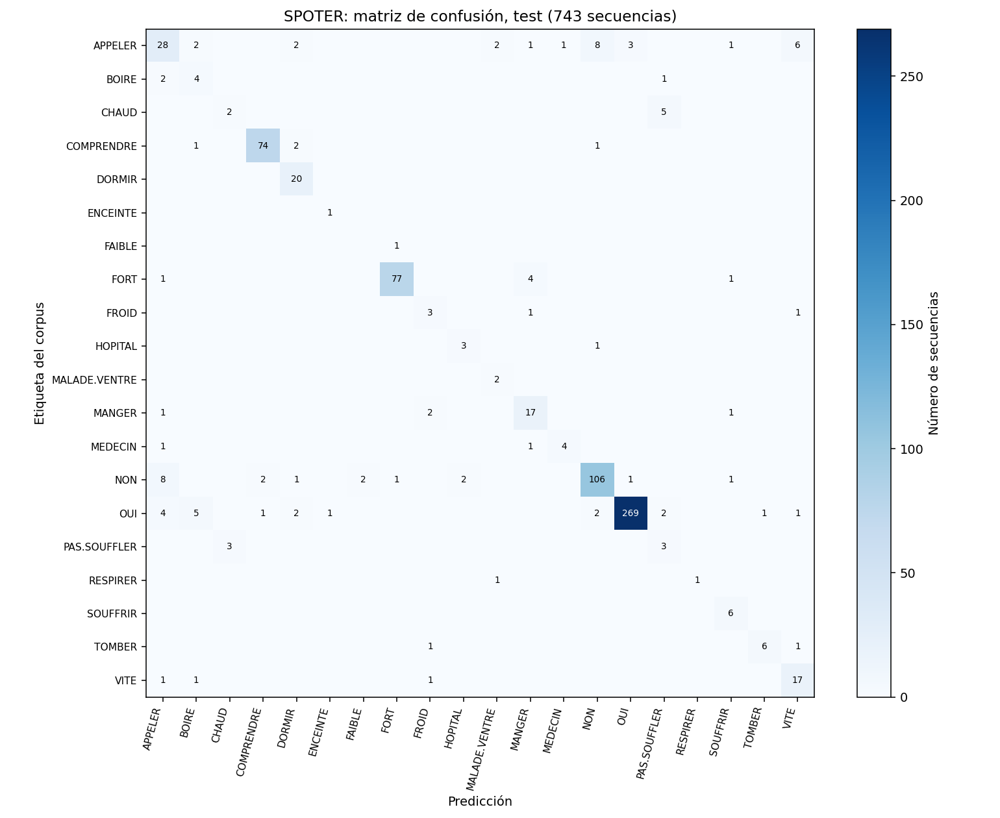

# MediSign Assist

**Recognize 20 isolated health-related signs from body and hand movements.**

MediSign turns a short pose sequence into a sign label using a SPOTER Transformer.
The desktop app supports a webcam, prerecorded pose files, a top-five ranking and
an abstention threshold. Its vocabulary comes from **French Belgian Sign Language
(LSFB)**; French labels are displayed alongside English translations.

**Python · PyTorch · MediaPipe · scikit-learn · Tkinter**

## How it works

```text
Webcam → MediaPipe body + hands ─┐
Recorded poses (.npy) ──────────┴→ normalization → SPOTER → label / repeat request
```

Each frame contains 225 coordinates: 33 body landmarks and 21 landmarks per hand,
with x/y/z values. The model uses the first 80 frames, with left padding for shorter
sequences. The app captures 50 frames by default, configurable up to the model limit.

## Recorded results

All three models were evaluated on the same signer-disjoint split. Model selection
used validation; the test set contains **743 sequences from 15 held-out signers**.

| Model | Validation macro F1 | Test macro F1 | Test accuracy |
|---|---:|---:|---:|
| Majority class | 0.032 | 0.028 | 38.76% |
| RBF SVM | 0.523 | 0.381 | 78.73% |
| **SPOTER** | **0.660** | **0.654** | **86.54%** |



The figure is preserved in its original language. See the [recorded metrics](results/metrics.csv),
[per-example predictions](results/predictions.csv) and [evaluation notes](docs/EVALUATION.md).

## Run the demo

The reference environment is **Windows x64, Python 3.13 with Tkinter**. Run commands
from the repository root. The CPU lock file comes from the working demo environment.

```powershell
python -m venv .venv
.venv\Scripts\python.exe -m pip install -r requirements-lock-cpu.txt
```

Model binaries are distributed separately as **`medisign-models.zip`**. Extract that
archive into the repository root so that `models/spoter_legacy/best_model.pt` and
`models/mediapipe/*.task` exist. The prepared local copy already includes these ignored
files. No public download URL is configured yet.

```powershell
.venv\Scripts\python.exe src/app.py --input examples/boire.npy
.venv\Scripts\python.exe src/app.py
```

In the window: **Load → Import poses** to use an example, or
**Load → Open camera → Capture → Finish** to record a sign. The model proposes a label
when its score reaches 0.70. This is an exploratory threshold, not calibrated confidence.
Use `--capture-frames 80` for a longer capture.

The three examples are `boire.npy` (drink), `hopital.npy` (hospital) and `non.npy` (no).
Their source IDs and selection procedure are in [the manifest](examples/manifest.json).
Initial dependency installation needs Internet access; the installed demo loads its
model and detectors locally. It does not save webcam video.

## Code and experiments

| Location | Purpose |
|---|---|
| `src/app.py`, `src/camera.py` | Desktop interface and landmark capture |
| `src/model.py`, `src/preprocessing.py` | Model, input validation and pose preparation |
| `src/data.py`, `src/artifacts.py` | Corpus checks, splits and model metadata |
| `src/pretrain.py`, `src/train.py`, `src/evaluate.py` | Training and evaluation commands |
| `tests/` | Inference, malformed inputs and camera-resource tests |
| `results/` | Selected original evaluation records |

```powershell
.venv\Scripts\python.exe -m unittest discover -s tests -v
```

See [reproduction instructions](docs/REPRODUCING.md) for the optional corpus archive,
baseline training and evaluation. The auxiliary pretraining corpus is not bundled.

## Scope and limitations

- Recognizes isolated signs; it does not translate continuous sentences or establish equivalence with French Sign Language (LSF).
- Results describe recorded corpus poses. Accuracy on live webcam users has not been established.
- Rare test classes have very small support. Accuracy should be read alongside macro F1 and per-class errors.
- Unknown gestures may receive a high score. This prototype has no clinical validation.
- The exact auxiliary checkpoint behind the historical medical weights was not recorded; a fresh training run is not claimed to reproduce those weights bit for bit.

## Team and references

MediSign Assist: **Mathis Herbreteau, Axel Bonneau and Quentin Richard**.

The project adapts the SPOTER architecture by Matyáš Boháček and Marek Hrúz and uses
LSFB-ISOL and MediaPipe. [Third-party notices and data attribution](NOTICE.md) distinguish
the team's code, dataset-derived examples and external models.
