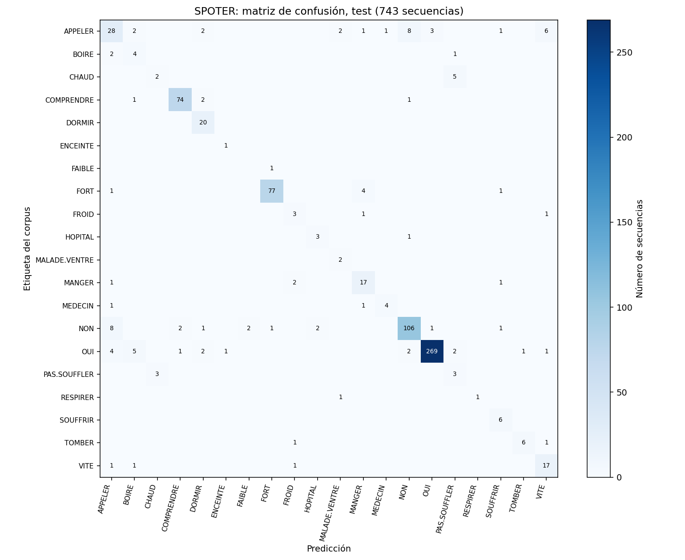

# Evaluation

## Data and split

The vocabulary selection contains 6,090 LSFB-ISOL sequences. Excluding 35 empty
sequences leaves 6,055 usable examples. A person's sequences belong to exactly one
partition; this is a local split, not the official LSFB benchmark split.

| Partition | Signers | Sequences |
|---|---:|---:|
| Train | 69 | 4,020 |
| Validation | 15 | 1,292 |
| Test | 15 | 743 |

Coordinates combine the body and both hands. Normalization changes x/y while retaining z.
The first 80 frames are retained and shorter sequences are padded on the left.

## Model comparison

The majority baseline always predicts the most common training sign. The RBF SVM
uses sequence summaries: means, standard deviations and mean absolute motion.
Its scaler is fitted on training data. C was selected from 0.1, 1 and 10 by validation
macro F1; C=10 was selected. SPOTER uses attention over pose sequences and the recorded
medical weights from October 6, 2026.

[metrics.csv](../results/metrics.csv) preserves the original six validation/test rows.
[predictions.csv](../results/predictions.csv) contains `split`, `model`, `id`, `signer`,
`sign` and `predicted`, allowing the classification metrics to be recalculated.
Model timing excludes webcam landmark extraction and preprocessing.

## Error analysis

SPOTER classifies 643 of 743 test examples correctly. It identifies two of seven
CHAUD examples; the other five are classified as PAS.SOUFFLER. OUI has 288 test
examples, while FAIBLE and ENCEINTE have only one each. Those differences explain
why overall accuracy alone is insufficient.

At the exploratory 0.70 threshold, the original validation analysis accepted 920
of 1,292 sequences and made 43 errors among accepted predictions. The main comparison
table uses top-one predictions on all examples, without threshold-based filtering.

## Runtime validation and limits

The supplied test suite exercises malformed and empty sequences, non-finite values,
the 80-frame limit, metadata consistency, offline model loading and camera resource
handling. It also checks that hand assignments follow body wrists.

The original source records successful recognition of the three pose examples.
Its separate video re-extraction check recognized BOIRE and HOPITAL and abstained
on NON. These are small demonstrations, not estimates of live webcam accuracy.

The original results and figures are preserved; preparing this repository does not
constitute a new training or benchmark run. The exact auxiliary pretraining checkpoint
of the historical medical run is unknown.
